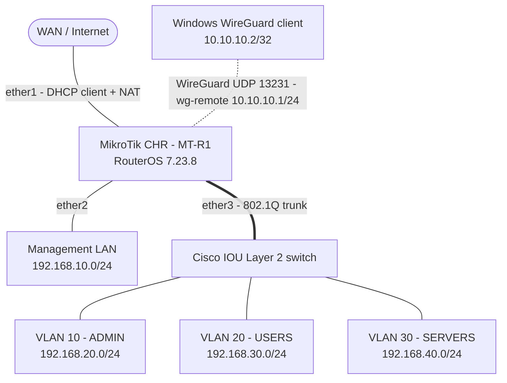

# MikroTik Enterprise Network Lab

A hands-on enterprise network infrastructure lab built with MikroTik CHR and Cisco Layer 2 switching, using VMware Workstation and GNS3.

This project demonstrates the design, implementation, configuration, hardening, and validation of a segmented enterprise network: VLANs, inter-VLAN routing, DHCP, NAT, a default-deny firewall, Layer 2 security, and secure remote access through WireGuard VPN.

---

## Table of Contents

- [Project Overview](#project-overview)
- [Objectives](#objectives)
- [Lab Environment](#lab-environment)
- [Network Architecture](#network-architecture)
- [VLAN and IP Addressing](#vlan-and-ip-addressing)
- [Key Implementations](#key-implementations)
- [WireGuard VPN](#wireguard-vpn)
- [Security Implementation](#security-implementation)
- [Testing and Validation](#testing-and-validation)
- [Screenshots](#screenshots)
- [Repository Structure](#repository-structure)
- [Documentation](#documentation)
- [Limitations](#limitations)
- [Possible Improvements](#possible-improvements)
- [Project Status](#project-status)
- [Author](#author)

---

## Project Overview

The purpose of this lab is to simulate a small enterprise network where departments and infrastructure services are isolated into separate VLANs.

- The **MikroTik CHR** router provides Layer 3 services: inter-VLAN routing, DHCP, NAT, firewall filtering and WireGuard VPN access.
- The **Cisco Layer 2 switch** provides VLAN segmentation, trunk connectivity and Layer 2 security features.
- Virtualization (VMware Workstation) and network simulation (GNS3) are combined to reproduce a realistic environment.

## Objectives

- Design a segmented enterprise network architecture.
- Configure VLANs and IEEE 802.1Q trunking.
- Implement inter-VLAN routing and DHCP services.
- Configure NAT for Internet access.
- Apply a default-deny firewall policy between network segments.
- Implement Layer 2 security mechanisms.
- Harden the router management plane.
- Deploy secure remote access using WireGuard VPN.
- Test connectivity, isolation and VPN functionality, and keep the evidence.

## Lab Environment

| Component | Technology |
|---|---|
| Router | MikroTik CHR (hostname `MT-R1`) |
| RouterOS Version | 7.23.8 |
| Layer 2 Switch | Cisco IOU |
| Virtualization | VMware Workstation |
| Network Simulation | GNS3 |
| VPN Protocol | WireGuard |
| VPN Client | Windows |
| Router Architecture | x86_64 |

## Network Architecture

The network is organized around the MikroTik CHR router:

- `ether1`: WAN, addressed by DHCP, with NAT masquerade.
- `ether2`: management LAN.
- `ether3`: IEEE 802.1Q trunk to the Cisco Layer 2 switch, carrying VLANs 10, 20 and 30.
- `wg-remote`: WireGuard interface for remote access.



Detailed topology documentation:

- [Network Topology Diagram](docs/topology-diagram.md)
- [Network Topology Documentation](docs/network-topology.md)

## VLAN and IP Addressing

The internal network is segmented into three functional VLANs, plus dedicated VLANs for unused ports and native trunk traffic. The subnet numbering is intentionally independent of the VLAN IDs.

| VLAN ID | Name | Network | Gateway | Purpose |
|---|---|---|---|---|
| 10 | ADMIN | 192.168.20.0/24 | 192.168.20.1 | Administration |
| 20 | USERS | 192.168.30.0/24 | 192.168.30.1 | User devices |
| 30 | SERVERS | 192.168.40.0/24 | 192.168.40.1 | Server infrastructure |
| 100 | UNUSED | n/a | n/a | Unused switch ports |
| 999 | NATIVE | n/a | n/a | Native VLAN on trunk |

Additional networks:

| Network | Interface | Address | Purpose |
|---|---|---|---|
| Management LAN | `ether2` | 192.168.10.0/24 (gateway 192.168.10.1) | Router management and lab access |
| WireGuard VPN | `wg-remote` | 10.10.10.0/24 (server 10.10.10.1) | Remote access |

### DHCP Configuration

DHCP services are configured on the MikroTik router for the management LAN and VLANs 10, 20 and 30.

| Segment | DHCP Pool |
|---|---|
| Management LAN | 192.168.10.100 - 192.168.10.200 |
| ADMIN (VLAN 10) | 192.168.20.100 - 192.168.20.200 |
| USERS (VLAN 20) | 192.168.30.100 - 192.168.30.200 |
| SERVERS (VLAN 30) | 192.168.40.100 - 192.168.40.200 |

For the complete addressing plan, see [IP Addressing](docs/ip-addressing.md).

## Key Implementations

### 1. MikroTik CHR Configuration

Implemented features:

- WAN connectivity through DHCP client.
- VLAN interfaces on the trunk port.
- Inter-VLAN routing.
- DHCP pools and DHCP servers.
- NAT masquerading.
- Default-deny firewall (input and forward chains).
- Management plane hardening.
- WireGuard VPN server.

See [MikroTik Configuration](configurations/mikrotik/README.md).

### 2. Cisco Layer 2 Switching

Implemented features:

- VLAN creation and management.
- IEEE 802.1Q trunking.
- Native VLAN configuration.
- DHCP Snooping.
- Port Security.
- BPDU Guard.
- Unused switch port isolation.

See [Cisco Switch Configuration](configurations/cisco-switch/README.md).

## WireGuard VPN

WireGuard provides secure remote access to the internal network.

### VPN Configuration

| Parameter | Value |
|---|---|
| Interface | wg-remote |
| VPN Server Address | 10.10.10.1/24 |
| Windows Client Address | 10.10.10.2/32 |
| UDP Port | 13231 |
| MTU | 1420 |
| VPN Mode | Split Tunneling |
| Access policy | Full access to internal segments, same privileges as ADMIN |

Split tunneling means Internet traffic from the Windows client keeps using its normal Internet connection instead of going through the tunnel.

The full-access policy for the VPN client is a deliberate choice for this lab. See [Possible Improvements](#possible-improvements) for how it would be restricted in production.

### Validation

- WireGuard handshake established between the Windows client and the CHR.
- Ping to the VPN gateway `10.10.10.1`.
- Ping to the ADMIN, USERS and SERVERS gateways.
- Internet connectivity test using `1.1.1.1`.

## Security Implementation

### Firewall Policy

The firewall follows a default-deny approach in both the `input` and `forward` chains: required traffic is explicitly allowed, and everything else is dropped.

General rules:

- Allow established and related connections.
- Drop invalid connections.
- Drop new connections arriving from the WAN.
- Allow only the WireGuard UDP port from the WAN.
- Final `drop` rule in the `input` chain.
- Final `drop` rule in the `forward` chain.

Resulting traffic matrix (return traffic of established connections is always allowed):

| From \ To | ADMIN | USERS | SERVERS | Mgmt LAN | VPN | Internet | Router |
|---|---|---|---|---|---|---|---|
| **ADMIN** | n/a | Allowed | Allowed | Allowed | Allowed | Allowed | Allowed |
| **USERS** | Blocked | n/a | Blocked | Blocked | Blocked | Allowed | Blocked |
| **SERVERS** | Blocked | Blocked | n/a | Blocked | Blocked | Allowed | Blocked |
| **Mgmt LAN** | Allowed | Allowed | Allowed | n/a | Blocked | Allowed | Allowed |
| **VPN client** | Allowed | Allowed | Allowed | Allowed | n/a | Allowed | Allowed |

USERS and SERVERS can only reach the Internet and the router's DHCP service. Initiating traffic from the WAN into the internal network is not possible.

### Router Hardening

- Insecure services disabled: `telnet`, `ftp`, `www`, `api`, `api-ssl`, `reverse-proxy`.
- Winbox and SSH restricted to the management LAN, the ADMIN VLAN and the VPN subnet.
- MAC-Server and MAC-Winbox disabled.
- Neighbor discovery disabled.
- Dedicated named administrator account used for management.

### Layer 2 Security (Cisco switch)

- DHCP Snooping.
- Port Security.
- BPDU Guard.
- Unused ports isolated in VLAN 100.

These features protect the Layer 2 infrastructure against rogue DHCP servers, unauthorized device connections and unwanted spanning-tree events.

## Testing and Validation

| Test | Result | Evidence |
|---|---|---|
| DHCP on management LAN and VLANs 10, 20, 30 | Pass | [DHCP leases](screenshots/testing/mikrotik-dhcp-leases.png) |
| ADMIN reaches USERS, SERVERS and VPN | Pass | [ADMIN access](screenshots/testing/admin-access-all.png) |
| USERS blocked to ADMIN, SERVERS, VPN and Mgmt LAN; Internet allowed | Pass | [USERS isolation](screenshots/testing/users-isolation-blocked.png) |
| SERVERS blocked to ADMIN, USERS, VPN and Mgmt LAN; Internet allowed | Pass | [SERVERS isolation](screenshots/testing/servers-isolation-blocked.png) |
| WireGuard handshake | Pass | [Handshake](screenshots/wireguard/wireguard-handshake.png) |
| VPN client reaches internal segments | Pass | [VPN access](screenshots/wireguard/vpn-access-all.png) |

Detailed results are available in [Testing and Validation](docs/testing-and-validation.md).

## Screenshots

### VLAN Configuration

- MikroTik VLAN interfaces: [View](screenshots/vlan/mikrotik-vlan-interfaces.png)
- Cisco VLAN and trunk configuration: [View](screenshots/vlan/cisco-layer2-vlan-trunk.png)

### Firewall and NAT

- Forward chain rules: [View](screenshots/firewall/mikrotik-forward-rules.png)
- Input chain rules: [View](screenshots/firewall/mikrotik-input-rules.png)
- NAT: [View](screenshots/firewall/mikrotik-nat.png)

### WireGuard VPN

- WireGuard handshake: [View](screenshots/wireguard/wireguard-handshake.png)
- VPN access to internal segments: [View](screenshots/wireguard/vpn-access-all.png)

### Testing

- DHCP leases: [View](screenshots/testing/mikrotik-dhcp-leases.png)
- ADMIN access: [View](screenshots/testing/admin-access-all.png)
- USERS isolation: [View](screenshots/testing/users-isolation-blocked.png)
- SERVERS isolation: [View](screenshots/testing/servers-isolation-blocked.png)

### Security

- Router services hardening: [View](screenshots/security/mikrotik-services-hardening.png)
- Users, MAC-server and neighbor discovery: [View](screenshots/security/mikrotik-hardening-users-mac-neighbors.png)
- Cisco DHCP Snooping: [View](screenshots/security/cisco-layer2-dhcp-snooping.png)
- Cisco Layer 2 security: [View](screenshots/security/cisco-layer2-security.png)

## Repository Structure

```text
mikrotik-enterprise-network-lab/
├── configurations/
│   ├── mikrotik/
│   │   ├── README.md
│   │   └── mikrotik-project6.rsc
│   └── cisco-switch/
│   │   ├── README.md
│   │   └── sw1-running-config.txt
├── docs/
│   ├── ip-addressing.md
│   ├── network-topology.md
│   ├── topology-diagram.md
│   ├── testing-and-validation.md
│   └── troubleshooting.md
├── screenshots/
│   ├── vlan/
│   │   ├── mikrotik-vlan-interfaces.png
│   │   └── cisco-layer2-vlan-trunk.png
│   ├── firewall/
│   │   ├── mikrotik-forward-rules.png
│   │   ├── mikrotik-input-rules.png
│   │   └── mikrotik-nat.png
│   ├── wireguard/
│   │   ├── wireguard-handshake.png
│   │   └── vpn-access-all.png
│   ├── testing/
│   │   ├── mikrotik-dhcp-leases.png
│   │   ├── admin-access-all.png
│   │   ├── users-isolation-blocked.png
│   │   └── servers-isolation-blocked.png
│   └── security/
│       ├── mikrotik-services-hardening.png
│       ├── mikrotik-hardening-users-mac-neighbors.png
│       ├── cisco-layer2-dhcp-snooping.png
│       └── cisco-layer2-security.png
└── README.md
```

The exported RouterOS configuration (`mikrotik-project6.rsc`) was generated with `/export hide-sensitive`, so no private keys or passwords are included.

## Documentation

- [IP Addressing Plan](docs/ip-addressing.md)
- [Network Topology](docs/network-topology.md)
- [Topology Diagram](docs/topology-diagram.md)
- [Testing and Validation](docs/testing-and-validation.md)
- [Troubleshooting](docs/troubleshooting.md)
- [MikroTik Configuration](configurations/mikrotik/README.md)
- [Cisco Switch Configuration](configurations/cisco-switch/README.md)

## Limitations

- Dynamic ARP Inspection (DAI) is not supported by the Cisco IOU image used.
- SSH management is not available on the IOU switch, so it is managed from the console.
- The lab runs in a simulated environment (GNS3, IOU, CHR), so throughput and hardware-specific behavior are out of scope.

## Possible Improvements

- Restrict the VPN client to the destinations it actually needs, with separate peer roles instead of full access.
- Add centralized logging (syslog) and NTP time synchronization.
- Enable DAI and SSH on the switch with a more complete image or real hardware.
- Automate configuration backups of the router and the switch.

## Project Status

**Core implementation completed. Firewall hardened and validated; documentation and validation evidence are included in this repository.**

## Author

**Seydou BA**

- GitHub: [c-seydouba](https://github.com/c-seydouba)
- LinkedIn: [Seydou BA](https://linkedin.com/in/seydouba-infra)
